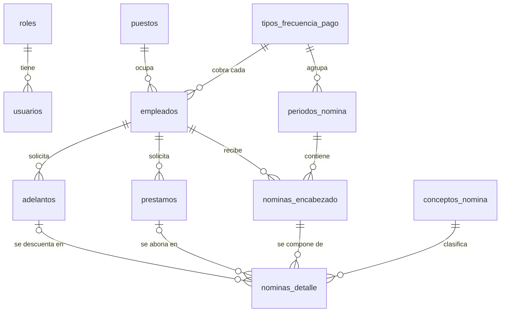

# Sistema de Nómina

Sistema administrativo para gestionar **empleados**, sus **pagos semanales o quincenales**, **adelantos** y **préstamos**, con inicio de sesión y roles para un número limitado de usuarios.

| Capa | Tecnología |
|---|---|
| Backend | NestJS 12 + TypeORM + PostgreSQL 17 |
| Autenticación | JWT + bcrypt, roles `ADMIN` / `OPERADOR` |
| Infraestructura | Docker Compose |
| Pruebas de API | Postman (colección en `postman/`) + Swagger |
| Frontend | Next.js *(en construcción)* |

---

## Cómo levantar el proyecto

Requisitos: **Docker Desktop**. Para desarrollar sin Docker también necesita **Node.js 24**.

```bash
# 1. Variables de entorno (solo la primera vez)
cp .env.example .env        # en Windows: copy .env.example .env

# 2. Levantar base de datos + backend
docker compose up -d --build
```

| Servicio | URL |
|---|---|
| API | http://localhost:3000/api |
| Documentación Swagger | http://localhost:3000/api/docs |
| Health check | http://localhost:3000/health |
| pgAdmin (opcional) | http://localhost:5050 · `docker compose --profile tools up -d` |

Al arrancar por primera vez se crean automáticamente las tablas (migraciones), los catálogos y el usuario administrador:

- **Usuario:** `admin` · **Contraseña:** `Admin123!` (cámbiela desde la app o en `.env` antes del primer arranque)
- Con `SEED_DEMO=true` también se crean 4 puestos y 4 empleados de ejemplo.

### Desarrollo del backend sin Docker

```bash
docker compose up -d db          # solo la base de datos
cd backend
cp .env.example .env
npm install
npm run start:dev                # recarga automática
npm test                         # pruebas unitarias
```

---

## Modelo de datos



### Cambios respecto al diseño original

El diseño original se respetó (mismas tablas y relaciones). Estas son las mejoras:

| Cambio | Por qué |
|---|---|
| `NombreApellido` → `nombres` + `apellidos` | Permite ordenar y buscar por apellido. |
| `Estado` de empleado como lista fija (`ACTIVO`/`INACTIVO`) | Evita valores escritos de distintas formas ("activo", "Activo "...). Lo mismo para préstamos, períodos y nóminas. |
| Nuevos campos en empleado: `fechaIngreso`, `email` | Un empleado contratado a mitad de período no se incluye en pagos anteriores a su ingreso. |
| `salarioBase` = **monto de cada pago** | Si es semanal, es lo que gana por semana; si es quincenal, por quincena. Así no hay que hacer conversiones. |
| `FotoDPI` se guarda como archivo, no dentro de la BD | La BD solo guarda el nombre. La foto **solo se descarga con sesión iniciada** porque es un dato sensible. |
| Conceptos con `esSistema` | `SUELDO_BASE`, `ADELANTO` y `PRESTAMO` los calcula el sistema y no se pueden borrar. Los demás (`BONO`, `HORAS_EXTRA`, `OTRO_DESCUENTO`...) los crea el administrador libremente. **Agregar un nuevo tipo de bono o descuento no requiere cambiar la base de datos.** |
| `createdAt` / `updatedAt` en todas las tablas | Auditoría básica: saber cuándo se creó o modificó cada registro. |
| Usuario: `ultimoAcceso` | Ver quién ha usado el sistema recientemente. |
| Restricciones `UNIQUE` y `CHECK` en la BD | Ningún DPI repetido, salarios y montos siempre positivos, saldo de préstamo nunca negativo ni mayor al total. Aunque alguien se salte la API, la base de datos lo impide. |
| Un empleado con una sola nómina por período (`UNIQUE periodo + empleado`) | Imposible pagarle dos veces el mismo período. |
| Nombres de tablas y columnas en `snake_case` | Convención estándar de PostgreSQL. |

---

## Cómo funciona el pago (flujo de nómina)

```
 ABIERTO ──(procesar)──▶ PROCESADO ──(cerrar)──▶ CERRADO
    ▲                        │
    └──────(revertir)────────┘
```

1. **Crear período**: se elige la frecuencia y la fecha de inicio. La fecha fin se calcula sola:
   - Semanal → 7 días.
   - Quincenal → del 1 al 15 y del 16 al último día del mes (incluido febrero).
   - El sistema sugiere las fechas del siguiente período y no permite períodos que se crucen.
2. **Procesar**: genera la nómina de cada empleado **activo** con esa frecuencia:
   - **+ Sueldo base**
   - **− Adelantos pendientes**: se descuenta cada adelanto completo.
   - **− Cuota de cada préstamo activo**: o el saldo, si es menor que la cuota.
3. **Revisar**: en estado PROCESADO se pueden agregar bonos o descuentos manuales a cada nómina. Si se corrige un dato (por ejemplo un adelanto), se revierte y se vuelve a procesar; los bonos manuales se conservan.
4. **Cerrar** (solo ADMIN): confirma el pago. Recién aquí los adelantos quedan como *aplicados* y se rebaja el saldo de los préstamos; un préstamo con saldo 0 pasa a *PAGADO*. Un período cerrado ya no se puede modificar.

**Reglas que protegen al usuario de errores**

- Un adelanto no puede superar lo que el empleado va a recibir en el siguiente pago.
- La cuota de un préstamo no puede ser mayor al salario del período.
- No se puede cerrar un período con nóminas en negativo.
- Solo puede haber un período PROCESADO por frecuencia a la vez, para no descontar el mismo adelanto dos veces.
- No se puede editar ni borrar un adelanto o préstamo que ya está en una nómina en proceso o pagada.
- Un empleado con historial no se borra: se marca INACTIVO.

---

## Roles

| Acción | ADMIN | OPERADOR |
|---|:-:|:-:|
| Empleados, adelantos, préstamos | ✅ | ✅ |
| Crear, procesar y revertir períodos; bonos manuales | ✅ | ✅ |
| **Cerrar período (confirmar pago)** | ✅ | ❌ |
| Eliminar empleados | ✅ | ❌ |
| Catálogos (puestos, conceptos) | ✅ | solo ver |
| Usuarios y roles | ✅ | ❌ |

---

## Endpoints principales

Todos bajo `/api` y con `Authorization: Bearer <token>` (excepto el login). La lista completa con ejemplos está en Swagger.

| Módulo | Rutas |
|---|---|
| Auth | `POST /auth/login` · `GET /auth/perfil` · `PATCH /auth/cambiar-password` |
| Usuarios | `GET/POST /usuarios` · `GET/PATCH/DELETE /usuarios/:id` · `GET /roles` |
| Catálogos | `/puestos` · `GET /frecuencias-pago` · `/conceptos-nomina` |
| Empleados | `GET/POST /empleados` · `GET/PATCH/DELETE /empleados/:id` · `GET /empleados/:id/estado-cuenta` · `POST/GET /empleados/:id/foto-dpi` |
| Adelantos | `GET/POST /adelantos` · `GET/PATCH/DELETE /adelantos/:id` |
| Préstamos | `GET/POST /prestamos` · `GET/PATCH/DELETE /prestamos/:id` · `PATCH /prestamos/:id/cancelar` |
| Períodos | `GET/POST /periodos-nomina` · `GET /periodos-nomina/sugerencia` · `GET/PATCH/DELETE /periodos-nomina/:id` · `POST /periodos-nomina/:id/procesar` · `/revertir` · `/cerrar` |
| Nóminas | `GET /nominas` · `GET /nominas/:id` (boleta) · `POST /nominas/:id/detalles` · `DELETE /nominas/:id/detalles/:detalleId` |
| Dashboard | `GET /dashboard/resumen` |

---

## Pruebas con Postman

En `postman/` hay una colección y un entorno:

1. En Postman: **Import** → seleccione los dos archivos de `postman/`.
2. Elija el entorno **Nómina - Local**.
3. Ejecute la carpeta **00 · Flujo completo de nómina** con el *Runner*. Recorre un caso real y verifica los cálculos: sueldo 1200 − adelanto 200 − cuota 250 + bono 100 = **líquido 850**.

Con Postman CLI:

```bash
postman collection run postman/sistema-nomina.postman_collection.json -e postman/local.postman_environment.json
```

El login guarda el token automáticamente. La colección se puede ejecutar varias veces seguidas: genera DPI y nombres únicos en cada ejecución.

---

## Estructura

```
sistema-nomina/
├── backend/
│   ├── src/
│   │   ├── auth/               login, JWT, guards
│   │   ├── usuarios/ roles/    acceso al sistema
│   │   ├── puestos/ frecuencias-pago/ conceptos-nomina/   catálogos
│   │   ├── empleados/ adelantos/ prestamos/
│   │   ├── periodos-nomina/    ciclo ABIERTO → PROCESADO → CERRADO
│   │   ├── nominas/            encabezado + detalle (boleta)
│   │   ├── dashboard/
│   │   ├── common/             enums, decoradores, filtros, utilidades
│   │   └── database/           migraciones, seed, naming strategy
│   └── Dockerfile
├── postman/
├── docker-compose.yml
└── .env.example
```

### Migraciones

El esquema se maneja con migraciones de TypeORM (nunca `synchronize`). Si cambia una entidad:

```bash
cd backend
npm run migration:generate -- src/database/migrations/NombreDelCambio
npm run migration:run
```
